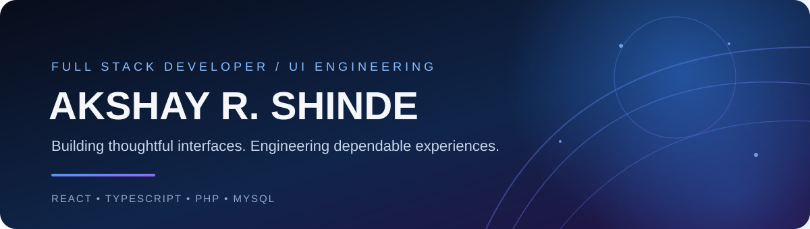
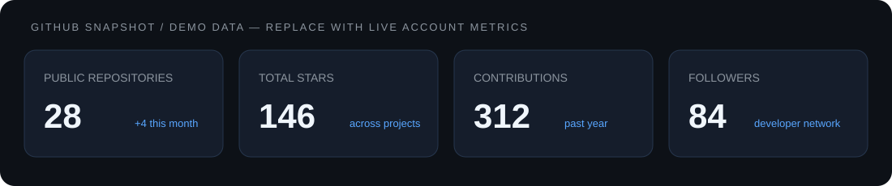
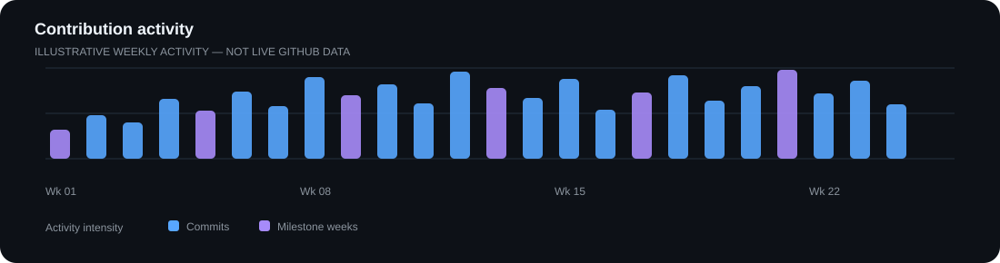
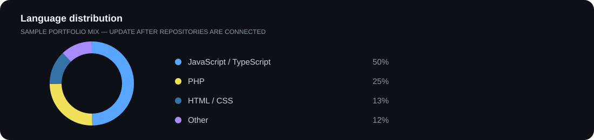
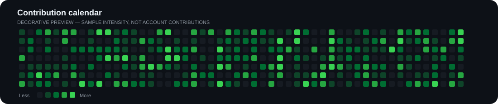

---

## 

### Engineering with a UI-first mindset.

I'm **Akshay R. Shinde**, a Full Stack Developer with **5+ years of experience** building enterprise applications across LMS, healthcare, e-commerce, POS and warehouse management.

I focus on frontend engineering—translating complex workflows into clean, responsive and maintainable interfaces. I work with React, TypeScript and modern JavaScript, and connect those experiences to backend services built with PHP, CodeIgniter and MySQL.

| Focus | What I bring |
|---|---|
| UI engineering | Component-driven development, responsive interfaces and reusable patterns |
| Application quality | Loading, empty and error states, debugging, testing and production support |
| Full stack delivery | REST API integration, PHP, CodeIgniter and MySQL |
| Team delivery | Agile/Scrum, code reviews, collaboration and releases |

## 

**Frontend & UI**

**Backend & data**

**Tools**

<strong>Full skills inventory</strong>

| Area | Skills |
|---|---|
| Frontend | React.js, TypeScript, JavaScript (ES6+), HTML5, CSS3, JSX, React Hooks, Redux Toolkit, Angular, jQuery, Tailwind CSS, Bootstrap, Vite |
| UI | Responsive UI, reusable components, component-based development |
| Backend | PHP, CodeIgniter, RESTful API development, API integration, OOP, role-based access control |
| Database | MySQL, database design, SQL query optimization |
| Testing | Jest, React Testing Library, unit testing, debugging, code reviews, quality assurance |
| Tools | Git, GitHub, ServiceNow, Power BI, xAPI, AWS Cloud Essentials |
| Practices | Agile/Scrum, SDLC, RESTful architecture, performance optimization |

---

## 

<table>
<tr>
<td width="50%" valign="top">

### Enrollment Portal
A learner management experience with bulk activation/deactivation workflows and role-based access control.

`React.js` `PHP` `REST APIs` `RBAC`

<a href="https://github.com/akshay-shinde-team?tab=repositories">↗ Browse project repositories</a>

</td>
<td width="50%" valign="top">

### TMTool
Trainer management application featuring analytics dashboards and trainee tracking modules.

`React.js` `Dashboards` `Data UI`

<a href="https://github.com/akshay-shinde-team?tab=repositories">↗ Browse project repositories</a>

</td>
</tr>
<tr>
<td width="50%" valign="top">

### E-commerce & POS
Commerce workflows covering cart, orders, payments, billing and taxation.

`React.js` `PHP` `MySQL`

<a href="https://github.com/akshay-shinde-team?tab=repositories">↗ Browse project repositories</a>

</td>
<td width="50%" valign="top">

### Elevate Tool
Application with REST API integrations, localization and country-specific content delivery.

`PHP` `CodeIgniter` `MySQL` `REST APIs`

<a href="https://github.com/akshay-shinde-team?tab=repositories">↗ Browse project repositories</a>

</td>
</tr>
</table>

---

## 

| 10,000+ | 25% | 100+ | 500+ |
|:---:|:---:|:---:|:---:|
| Learners supported | Data-load improvement | Production issues resolved | Concurrent users supported |

| 40% | 35% |
|:---:|:---:|
| Fewer checkout-flow errors | Page-load improvement |

Professional project outcomes from my experience. These are not GitHub account statistics.

---

## 

> **Preview mode:** The graphs and counts below are intentionally illustrative dummy data so the profile has a complete visual layout before live GitHub statistics are configured. They do not represent actual account activity.

### Live GitHub cards (optional)

These external cards are included as a secondary live-data option. They require the username and third-party services to be available.

---

## 

| Organization | Position | Timeline |
|---|---|---|
| **Altera Digital Healthcare** | Full Stack Developer — React.js / PHP | Apr 2023 – Present |
| **HilstorIt Solutions Pvt Ltd** | Full Stack Developer — React.js / PHP | Jun 2021 – Mar 2023 |
| **Spectrum Consultants India Pvt Ltd** | Process Executive — AI/ML Video Labeling | Jan 2021 – Jun 2021 |
| **Vencent Systems Pvt Ltd** | Web Developer Intern | Jan 2020 – Mar 2020 |

<strong>Selected delivery highlights</strong>

- Developed and maintained enterprise LMS applications supporting **10,000+ learners globally**.
- Built reusable React modules and integrated REST APIs with loading, empty and error states.
- Optimized PHP APIs and MySQL queries, improving data-load performance by **25%**.
- Resolved **100+ production issues** through ServiceNow within SLA.
- Delivered e-commerce, POS and warehouse systems supporting **500+ concurrent users**.
- Integrated third-party payment gateways and REST APIs, reducing checkout-flow errors by **40%**.
- Optimized MySQL queries and schemas, reducing average page-load time by **35%** on high-traffic product pages.

---

## 

<table>
<tr>
<td width="50%" valign="top">

**Master of Computer Science**

Savitribai Phule Pune University

`2023 – 2025`

**CGPA: 8.25 / 10.0**

</td>
<td width="50%" valign="top">

**Bachelor of Computer Science**

Savitribai Phule Pune University

`2017 – 2020`

**CGPA: 8.29 / 10.0**

</td>
</tr>
</table>

---

## 

  

<a href="https://github.com/akshay-shinde-team">GitHub profile</a>
&nbsp; · &nbsp;
<a href="https://github.com/akshay-shinde-team?tab=repositories">Browse repositories</a>
&nbsp; · &nbsp;
<a href="mailto:akshayshinde4754@gmail.com">Send an email</a>

  

Built with intention. Styled with precision. Maintained with consistency.

